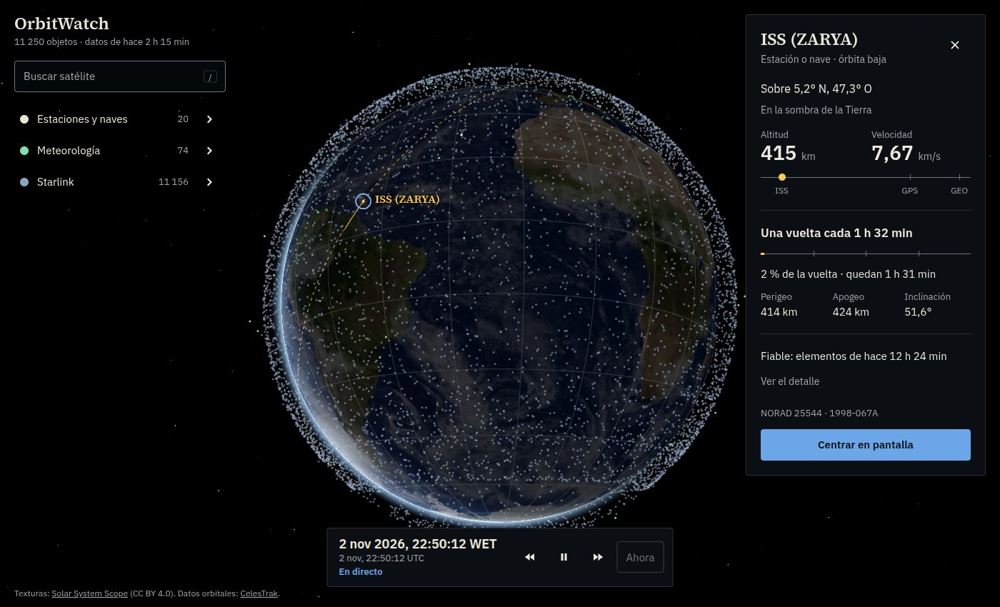

# OrbitWatch

Visualizador 3D de satélites en órbita, en el navegador, sobre una Tierra real y con una hora simulada que se puede adelantar y atrasar. Proyecto de portfolio, con el rendimiento medido y cada decisión técnica explicada.

> Demo: <https://hugogonzalezperez.github.io/orbitwatch/> (se publica con una GitHub Action; ver [docs/DESPLIEGUE.md](docs/DESPLIEGUE.md)).



## Para quién

Para quien lo abre desde un portfolio y quiere entender en pocos segundos qué está viendo, y para el aficionado a los satélites que busca uno concreto, lo elige y consulta su posición, su órbita y cuánto fiarse de los datos.

## Qué hace

- **Un globo con ~19 500 objetos** reales en 13 categorías por función (estaciones y naves, meteorología, navegación, Starlink, otras constelaciones, observación de la Tierra, ciencia, militares, geoestacionarios, radioaficionados, CubeSats, otros activos y restos de colisiones, estos ocultos al principio), con datos orbitales de [CelesTrak](https://celestrak.org/) propagados con SGP4.
- **Tiempo simulado:** adelante, atrás, pausa y vuelta a la hora de tu equipo. La cámara está fija y es la Tierra la que gira, con la luz del Sol real a la hora mostrada (terminador, brillo del mar, sombra de la Tierra sobre el satélite elegido), atmósfera y estrellas.
- **Elegir un satélite** pulsándolo en el globo, desde la lista de su categoría o buscándolo por nombre o número NORAD. La cámara vuela hasta él, se aleja lo necesario para ver su órbita entera y se dibuja la vuelta actual (continua lo recorrido, discontinua lo que falta).
- **Una ficha** con qué es y en qué órbita está, sobre qué punto de la Tierra, su altitud y velocidad (con una regla que la sitúa entre la superficie, la ISS, el GPS y la órbita geoestacionaria), cuánto tarda en dar una vuelta, perigeo, apogeo, inclinación y **cuánto fiarse de los datos** (edad de la descarga y distancia a la época de los elementos).
- **Leyenda y búsqueda** que filtran: cada categoría se puede ocultar en el globo y lo que no coincide con la búsqueda se atenúa.

## Cómo se maneja

| Gesto | Efecto |
| --- | --- |
| Arrastrar / rueda | Girar / acercar y alejar (de ≈ 2 000 a ≈ 120 000 km de la superficie) |
| Pulsar un punto | Elegir ese satélite; pulsar en el vacío o `Esc` lo deselecciona |
| Pasar el ratón sobre un punto | Muestra su nombre |
| `/` | Enfoca el buscador (flechas y `Enter` para elegir, `Esc` para cerrar o borrar) |
| Interruptor y flecha de cada categoría | Mostrar u ocultar en el globo / desplegar la lista |
| Controles del reloj | Retroceder, pausar o reanudar, avanzar, y «Ahora» para volver a la hora del equipo |
| `?t=2026-03-20T14:46:00Z` en la URL | Arranca el reloj en esa hora, en pausa |
| `?perf` en la URL | Muestra métricas de rendimiento abajo a la derecha (dibujos por segundo, CPU, llamadas de dibujo, Worker) |

La interfaz está pensada para escritorio; en pantallas estrechas aún no se adapta.

## Puesta en marcha

Requisitos: Node 22 y npm. (Probado con Node 22.)

```bash
npm install
npm run data       # descarga los datos de CelesTrak a public/data/ (una vez cada 2 h como máximo)
npm run dev        # servidor de desarrollo (http://localhost:5173)
```

Otros comandos: `npm test` (Vitest), `npm run typecheck`, `npm run build` (typecheck y build de producción en `dist/`), `npm run bench` (mide el cálculo del enjambre y la selección; ver [RENDIMIENTO.md](docs/RENDIMIENTO.md)).

**Importante:** los datos no se versionan. Descargar los 20 grupos tarda unos 33 s; si ya los bajaste hace menos de 2 h, el script usa la caché y no vuelve a pedir nada.

## Cómo está hecho

Resumen; el detalle y los motivos, en la documentación.

- **three.js directo** (sin motor geoespacial) y **React solo para los paneles**: el motor 3D es imperativo y no pasa por el estado de React.
- **Escena inercial:** la cámara no se mueve y la Tierra gira según su ángulo sidéreo, en el mismo marco (TEME) en que SGP4 da las posiciones, así que no hay que convertir cada satélite.
- **Todo el enjambre en una sola llamada de dibujo** y render solo cuando algo cambia: un globo quieto no gasta GPU.
- **El cálculo de las órbitas (SGP4) va en un Worker**, un hilo aparte, y entre cálculos el shader mueve cada punto con su velocidad: el hilo que dibuja queda libre (0,7 ms de CPU por actualización a ×600, medido). Ver el [glosario](docs/GLOSARIO.md).
- **Texturas KTX2** (compresión Basis ETC1S): el mapa de día de 8K pesa 2,6 MB y se queda comprimido en la GPU.
- **Los datos los baja un script**, no el navegador, para respetar la política de CelesTrak; la web solo lee ficheros estáticos.
- **Cada afirmación de rendimiento está medida** o dice que no lo está.

## Documentación

- [ARCHITECTURE.md](ARCHITECTURE.md): cómo encajan las piezas, flujo de datos y estructura de carpetas.
- [docs/DECISIONES.md](docs/DECISIONES.md): cada decisión, por qué, qué alternativas se descartaron y las fuentes consultadas.
- [docs/DATOS.md](docs/DATOS.md): origen de los datos, categorías, política de CelesTrak, validación, frescura y tamaños.
- [docs/DESPLIEGUE.md](docs/DESPLIEGUE.md): cómo se publica y se refresca, y qué pasa si CelesTrak falla.
- [docs/RENDIMIENTO.md](docs/RENDIMIENTO.md): qué está medido (y cómo) y qué no.
- [docs/CONVENCIONES.md](docs/CONVENCIONES.md): reglas del código y los problemas encontrados por el camino.
- [docs/HOJA-DE-RUTA.md](docs/HOJA-DE-RUTA.md): qué falta para darlo por concluido, por fases.
- [docs/GLOSARIO.md](docs/GLOSARIO.md): SGP4, Worker, TEME y demás términos.
- [DESIGN.md](DESIGN.md): el lenguaje visual de la interfaz.

## Límites conocidos

- **La precisión es limitada:** con elementos orbitales públicos la posición tiene errores de kilómetros y crece al alejarse de la época; la ficha lo avisa. OrbitWatch es una visualización, no una herramienta operativa.
- Solo escritorio. Sin medidas de rendimiento en una GPU real todavía.
- Las nubes son una foto fija, no el tiempo real. Las estrellas son aleatorias, no las de un catálogo.
- «Estaciones y naves» es el grupo `stations` de CelesTrak e incluye algunos restos y módulos; no hay datos para separarlos.

## Pendiente

SATCAT (país, tipo y fecha de lanzamiento), descarga y despliegue automáticos, cribado de acercamientos entre objetos con su benchmark, país y propietario de cada satélite, colores por régimen orbital, versión móvil, mapa de noche y relieve. La hoja de ruta con fases e hitos está en [docs/HOJA-DE-RUTA.md](docs/HOJA-DE-RUTA.md).

## Licencia y créditos

Código bajo licencia [MIT](LICENSE). Lo que no es código propio (texturas de [Solar System Scope](https://www.solarsystemscope.com/textures/) con licencia CC BY 4.0, datos de [CelesTrak](https://celestrak.org/), fuentes tipográficas y bibliotecas) se detalla en [THIRD_PARTY_NOTICES.md](THIRD_PARTY_NOTICES.md).
